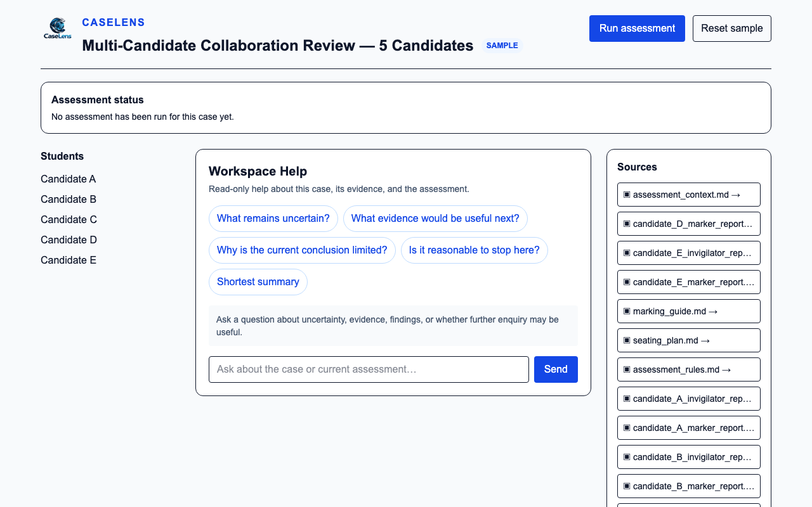
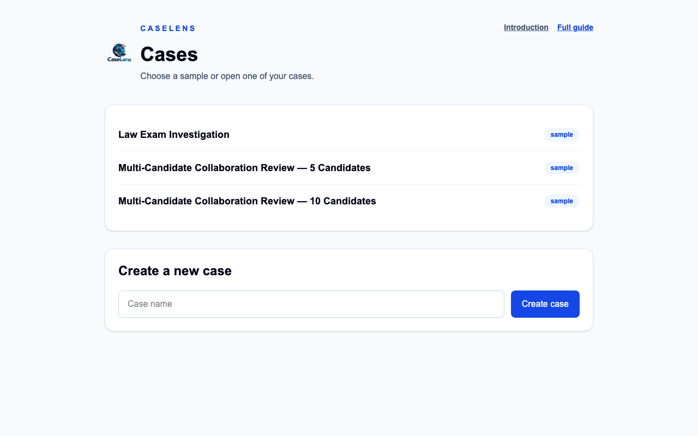
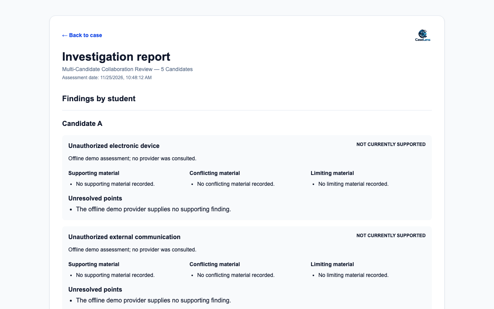

# CaseLens

CaseLens is an investigation assistant for academic-integrity reviews. A reviewer admits textual evidence into a case, runs a bounded assessment of each configured student against the configured policy, and reads a report that keeps evidence, claims, conflicts and uncertainty apart. A read-only Help assistant answers questions about the case.

CaseLens does not decide guilt. It shows what the admitted record does and does not support, and every conclusion stays with the human reviewer.



| Cases | Assessment report |
| --- | --- |
|  |  |

## Try it without an API key

The offline demo runs the real HTTP API and the real assessment path. An in-process fake stands in for the model provider, so no credential is read and no paid call is made. The fake returns fixed, schema-valid placeholder judgements. Use it to see the workflow, not to judge model reasoning.

Requirements: [uv](https://docs.astral.sh/uv/), Python 3.12 or later, Node.js 22 or later.

```bash
# Terminal 1: backend, from the repository root
uv sync
uv run python scripts/offline_demo_server.py --repository data/cases --port 8000

# Terminal 2: frontend
cd frontend
npm ci
npm run dev -- --hostname 127.0.0.1 --port 3000
```

Open `http://127.0.0.1:3000`. Under **Cases**, open a sample, run an assessment, and read the report. Samples are read-only; add your own case with **Create case**.

## Run with a real model provider

Copy `.env.example` to `.env` (gitignored) or export the same variables in your shell. Set `ANTHROPIC_API_KEY` for the default provider, then start the backend in provider mode:

```bash
CASELENS_MODEL_PROVIDER=anthropic \
  uv run python -m investigator.http_api --repository data/cases --host 127.0.0.1 --port 8000
```

Start the frontend as in the demo. An assessment with admitted evidence makes paid provider calls; a zero-evidence assessment makes none, so start with the smallest sample you need. Bedrock is available as an explicit alternative with `CASELENS_MODEL_PROVIDER=bedrock`, `BEDROCK_MODEL_ID` and your usual AWS setup. Approved models are listed in `src/investigator/model_registry.py`.

Temporary AWS credential overrides from the runtime settings panel are accepted only when `SIMPLIFYNEXT_DEBUG_CREDENTIALS=1`, and they are kept in the running process only.

## How it works

1. **Cases.** A case has one or more configured students. A new case starts with Student 1. Samples come with their own students and evidence.
2. **Evidence.** Upload readable `.txt` or `.md` records such as statements, reports, logs or correspondence. Only admitted evidence is assessed. There is no minimum count, and an empty case can be assessed, though it produces limited findings.
3. **Assessment.** Each run assesses every configured student separately against the configured violations. Model output is validated before it touches state: schema, cross-field rules, identifiers and references are checked, and output that fails is rejected rather than applied. Identifiers are kept apart from explanatory text.
4. **Report.** Each completed run is published as an immutable report. For each student it shows the status, supporting material, limiting or conflicting material, and unresolved points. `NOT_CURRENTLY_SUPPORTED` means the present record does not support the violation. It does not mean innocence has been established.
5. **Help.** Workspace Help is read-only. It can explain what remains uncertain, what evidence would help next, and why a conclusion is limited. It cannot change the case.
6. **Trace.** Every run writes a sanitized JSONL trace that can be downloaded from the workspace, whether the run completed or failed. Traces omit credentials and raw provider payloads.

Underneath, a deterministic case-state kernel in `src/investigator/graph/` keeps evidence, propositions, hypotheses and uncertainties as separate records with explicit relationships. Graph strength labels are descriptive, not probabilities.

## Repository layout

| Path | What it holds |
| --- | --- |
| `src/investigator/` | Python package: HTTP API (`http_api.py`), case graph, typed models, the assessment path (`vnext/`), model providers (`llm/`), and the Help guide. |
| `frontend/` | Next.js 16 interface (App Router) and Playwright browser tests. |
| `scripts/` | Offline demo server, live validation and fixture-loading scripts. |
| `tests/` | pytest suite, run without any provider key. |
| `experiments/` | Historical experiment code and its recorded reports. |
| `validation/` | Notes on which retained validation artifacts are included. |
| `docs/history/` | Earlier audits and readiness notes. They describe past stages and may be out of date. |
| `data/cases/` | Local case store, gitignored. |

## Checks

```bash
uv sync --all-groups
uv run ruff check . && uv run ruff format --check .
uv run pytest -q

cd frontend
npm ci
npm run lint && npm run format:check && npm run build
npx playwright test
```

The browser tests start their own offline backend. They make no provider calls. The same checks run on every pull request through `.github/workflows/checks.yml`.

## Limits

- **Not a detector or a decision-maker.** CaseLens is not a plagiarism detector, an AI-content detector, an automatic cheating detector, or a disciplinary decision-maker. It does not establish guilt or innocence.
- **Local operator tool.** There is no user authentication. `SIMPLIFYNEXT_ALLOWED_ORIGINS` limits which browser origins may call the API, but that is not access control. Run it on a loopback address or a network you trust.
- **Text evidence only.** Admitted evidence must be readable `.txt` or `.md`. Images, scans and other formats are not assessed.
- **Model quality is not established by the tests.** The offline suite and demo use fixed fakes. Live reasoning quality is evaluated separately and is not claimed by this repository.
- **Paid calls and failures.** An assessment with admitted evidence calls the configured provider, which is billed. A provider read timeout is reported as a failure and is not retried automatically. Runs cannot be resumed after an interruption.
- **Local JSON storage.** Cases are stored as local JSON files under `data/cases/`. There is no database and no multi-user access control.

## Licence

CaseLens is released under the [MIT Licence](LICENSE).
